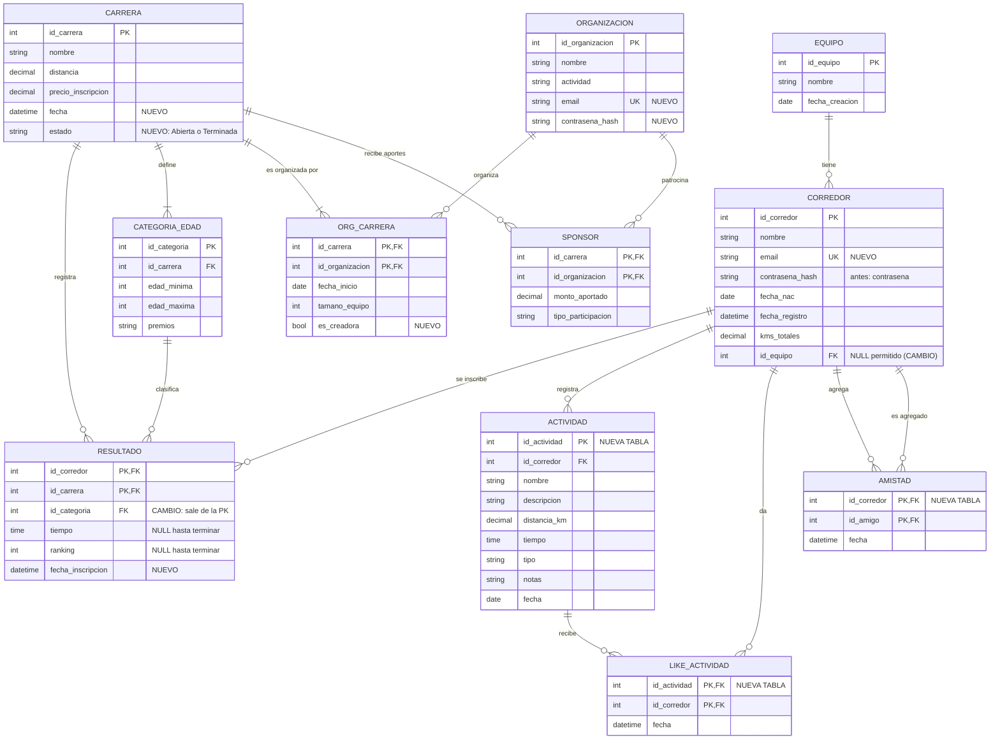

# ISIRUN: DER actualizado

GitHub muestra este diagrama automáticamente. Para la entrega en PDF o imagen, se puede pegar en https://mermaid.live y exportarlo como PNG o SVG.

## Cambios respecto del DER original

| # | Cambio | Motivo |
|---|---|---|
| 1 | `Carrera.estado` (Abierta / Terminada) | Una carrera terminada ya no acepta inscripciones, y solo una terminada muestra el ranking. |
| 2 | `Carrera.fecha` | El DER original no tenía fecha. Hace falta para el catálogo y para filtrar el reporte de inscripciones por período. |
| 3 | `Organizacion.email` y `Organizacion.contrasena_hash` | Las organizaciones ahora inician sesión para crear y gestionar sus carreras. |
| 4 | `Corredor.email` (único) y `contrasena` → `contrasena_hash` | Se entra con el correo, y la contraseña nunca se guarda en texto plano. |
| 5 | `Corredor.id_equipo` acepta NULL | En el DER original el corredor pertenece obligatoriamente a un equipo, pero en la app puede registrarse sin equipo y unirse después. |
| 6 | La PK de `Resultado` pasa a ser (`id_corredor`, `id_carrera`) y `id_categoria` queda como FK | Impide que un corredor se inscriba dos veces en la misma carrera en categorías distintas. La categoría se asigna según su edad. |
| 7 | `Resultado.tiempo` y `ranking` aceptan NULL, y se agrega `fecha_inscripcion` | La inscripción crea el registro vacío. Al terminar la carrera se completan el tiempo (simulado) y el ranking. |
| 8 | `Org_carrera.es_creadora` | Distingue a la organización que creó la carrera, la única que puede editarla, terminarla o eliminarla, de las co-organizadoras. |
| 9 | Nuevas tablas `Actividad`, `Like_actividad` y `Amistad` | Vienen del proyecto anterior: registro de entrenamientos, feed con likes y amigos. |

## Restricciones importantes
- `Categoria_edad`: `edad_minima <= edad_maxima`, y los rangos de una misma carrera no se superponen.
- `Resultado`: solo se crea si la carrera está *Abierta*, y la categoría debe pertenecer a esa misma carrera.
- `Carrera`: solo se elimina mientras está *Abierta*. Al eliminarla se borran en cascada sus categorías, inscripciones, `Org_carrera` y `Sponsor`.
- `Amistad`: `id_corredor <> id_amigo`.
- `Like_actividad`: un like por corredor y actividad (la PK compuesta lo garantiza).
